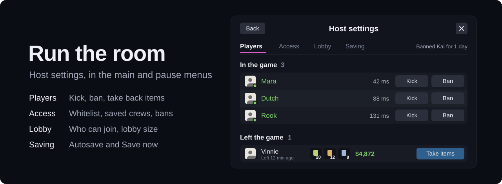

<p align="center">
  
</p>

Friends join any time, rejoin after a crash, and nobody loses progress. Only the host installs it.

<a href="https://github.com/mdoodm/BiggerLobbies/releases/latest"></a>


**[Download the latest release](https://github.com/mdoodm/BiggerLobbies/releases/latest)** or read [how to install](#install)

---

## What you get

Schedule I's co-op stops at 4 players, and one crash can end the night. BiggerLobbies takes those limits away, and everyone else joins with the normal game.

- **Room for everyone.** 20 players by default, and anything up to 250 if your PC and connection can carry it.
- **Invite whenever you like.** Your game goes online as your save loads, so friends can accept an invite or use Steam's **Join Game** at any point in the session.
- **Crashes don't end the session.** A player whose game crashes can come straight back in, without you restarting.
- **Nobody loses progress.** The world saves every 5 minutes, each player every 30 seconds, and everything saves the moment someone drops.
- **Everyone sees the same plants.** Water levels and growth stay in step for every player, so a watered pot never shows as dry.

## Run the room

<p align="center">
  
</p>

**Host settings** sits under Settings in the main menu and the pause menu, or press **F6** while you host. Changes apply straight away, without a restart.

- **Players.** See everyone's ping. Kick lets them rejoin; Ban keeps them out for an hour, a day, a week or for good, with an optional reason. Players who also have BiggerLobbies are told why they were removed, and removed players drop off your lobby screen. For players with BiggerLobbies you also see their version and any mods they're missing.
- **Take items.** Someone grabbed the product and left? Move their items and cash into your inventory, and they don't get them back if they rejoin. Every take is logged, with a copy of what they had. Changed your mind? **Give back** returns what you still carry to their empty slots.
- **Access.** Build a whitelist from your Steam friends, save it as a crew, and load it next session in one click. Bans are saved between games and end on their own.
- **Lobby.** Private, Friends only or Open, and the lobby size, even while friends are in.
- **Saving.** How often the world and each player save, plus a Save now button.
- **Discord.** Your profile shows "Hosting a lobby, Friends only (3 of 20)" under Playing Schedule I. Player count, lobby type and save name can each be turned off; the save name is off by default.

## Install

You need **Schedule I 0.4.7** (the default Steam branch).

1. Install <a href="https://github.com/LavaGang/MelonLoader/releases/latest"><b>MelonLoader v0.7.3</b></a> or later into the game folder.
2. Download `BiggerLobbies_Il2cpp.dll` from the [latest release](https://github.com/mdoodm/BiggerLobbies/releases/latest) and put it in `Schedule I\Mods\`.
3. Launch the game, load a save, and invite your friends.

Updating? Replace the DLL. Your settings, bans and crews carry over.

Each release lists the DLL's SHA-256. To check your download in PowerShell:

```
Get-FileHash .\BiggerLobbies_Il2cpp.dll -Algorithm SHA256
```

> [!TIP]
> **Losing leaves, petrol or deliveries?** That's a bug in the base game, not the lobby. The companion mod [**ItemSafety**](https://github.com/mdoodm/ItemSafety) catches it on the host. It's in alpha, so back up your saves first.

## Settings

Everything is on by default, and most of it is easier to change in **Host settings**. To edit the file instead, open `UserData\MelonPreferences.cfg` after the first launch, change values under `[BiggerLobbies]`, then restart the game.

<details>
<summary><b>All settings</b></summary>

**Lobby and access**

| Setting | Default | What it does |
|---|---|---|
| `MaxPlayers` | `20` | Lobby size, from 4 to 250. See [hosting big lobbies](docs/hosting-big-lobbies.md) |
| `LobbyPrivacy` | `FriendsOnly` | Who can join: `Private` (invite only), `FriendsOnly` or `Open` (strangers can join too) |
| `WhitelistEnabled` | `false` | Only players on the whitelist can join. The list starts empty each time you start the game |
| `SavedCrews` | empty | Named whitelists. Easiest to manage in Host settings |
| `BannedPlayers` | empty | Banned Steam IDs, with an optional end time. Saved between games |
| `HostPanelKey` | `F6` | Key that opens Host settings while you host |

**Discord**

| Setting | Default | What it does |
|---|---|---|
| `DiscordPresence` | `true` | Show what you're doing under "Playing Schedule I" on Discord. Needs Discord running on your PC |
| `DiscordShowPlayers` | `true` | Show the player count, like (3 of 20) |
| `DiscordShowLobbyType` | `true` | Show Friends only, Open or Private |
| `DiscordShowSaveName` | `false` | Show your organisation's name. Anyone who can see your profile can read it |
| `DiscordAppId` | Schedule I's | The Discord application the presence is sent as. The default is Discord's own entry for the game, which has no logo. Register your own at discord.com/developers to show one |
| `IgnoredModNames` | empty | Mod names, separated by commas, to leave out when comparing your mods with a player's. HUD mods and MLVScan are always left out |

**Joining**

| Setting | Default | What it does |
|---|---|---|
| `AlwaysHostLobby` | `true` | Go online automatically when you load a save |
| `LateJoinEnabled` | `true` | Let players join a game that has already started |

**Saving and sync**

| Setting | Default | What it does |
|---|---|---|
| `AutoSaveEnabled` | `true` | Save the world every few minutes, and when a player leaves |
| `AutoSaveMinutes` | `5` | Real-time minutes between world saves |
| `PlayerSaveEnabled` | `true` | Save each connected player between world saves |
| `PlayerSaveSeconds` | `30` | Seconds between player saves |
| `PlantSyncEnabled` | `true` | Send pot water levels and growth to every player |
| `PlantSyncMinutes` | `30` | In-game minutes between full resyncs of each pot |

**Logs**

| Setting | Default | What it does |
|---|---|---|
| `DiagnosticLog` | `false` | Write detailed lines to the MelonLoader log. Otherwise only warnings and errors are logged |

There are also two [testing tools](docs/hosting-big-lobbies.md#testing-tools) for checking a big lobby without a big group. Leave them at `0`.

</details>

## Good to know

- Friends don't need the mod. If they run MelonLoader for other mods, it must be v0.7.3 or later.
- Every player needs the same content mods as the host. A mod that adds new items or objects on the host but not on a friend's game breaks their world.
- With r2modman, launch with Start modded, not from Steam.
- It's built for the Il2Cpp game, the default Steam branch. The Mono (alternate) branch isn't supported on 0.4.7.
- MelonLoader won't load it alongside ModManager & PhoneApp.

## Read more

| Page | For when you want to |
|---|---|
| [Hosting big lobbies](docs/hosting-big-lobbies.md) | Go past 20 players, understand the limits, or test a big lobby on your own |
| [Troubleshooting](docs/troubleshooting.md) | Fix a load error, a friend who can't join, or lost progress |
| [Coming from ifBars/BiggerLobbies](docs/coming-from-ifbars.md) | Switch from the original mod and see what changed |
| [How it works](docs/how-it-works.md) | Read what each fix does inside the game, or build from source |
| [Changelog](CHANGELOG.md) | See what's new in each version |

Found a bug, or ran a big session? [Open an issue](https://github.com/mdoodm/BiggerLobbies/issues/new/choose). The templates ask for the logs that help.

## Credits

BiggerLobbies was created by **Bars** ([ifBars/BiggerLobbies](https://github.com/ifBars/BiggerLobbies)). This fork, with the 0.4.7 update and everything since, is by [mdoodm](https://github.com/mdoodm), with AI assistance. Released under the [MIT licence](LICENSE).
