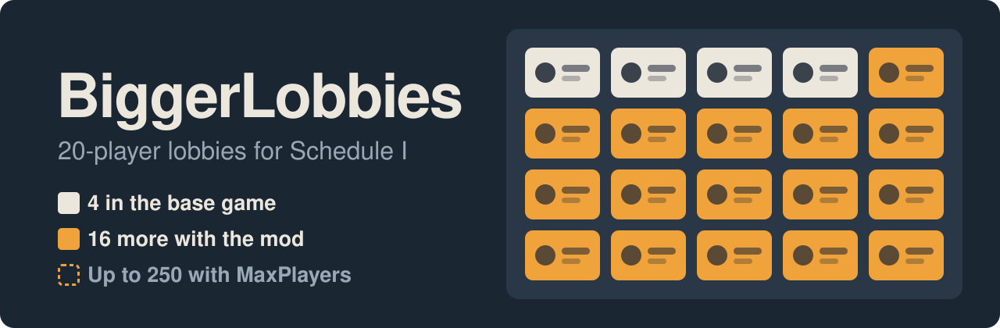

<p align="center">
  
</p>

<p align="center">
  <b>Play Schedule I with up to 20 friends, rejoin after a crash, and stop losing progress.</b>
</p>

<p align="center">
  <a href="https://github.com/mdoodm/BiggerLobbies/releases/latest"></a>
  
  
  <a href="LICENSE"></a>
</p>

<p align="center">
  <a href="https://github.com/mdoodm/BiggerLobbies/releases/latest"><b>Download the latest release</b></a>
  &nbsp;&nbsp;|&nbsp;&nbsp;
  <a href="#install">Install in 2 minutes</a>
  &nbsp;&nbsp;|&nbsp;&nbsp;
  <a href="#coming-from-ifbarsbiggerlobbies">Coming from ifBars?</a>
  &nbsp;&nbsp;|&nbsp;&nbsp;
  <a href="CHANGELOG.md">Changelog</a>
  &nbsp;&nbsp;|&nbsp;&nbsp;
  <a href="https://github.com/mdoodm/ItemSafety">Companion: ItemSafety</a>
</p>

---

## Why use it

Schedule I's multiplayer stops at 4 players, and the host has to restart the session whenever something goes wrong. BiggerLobbies fixes the parts that get in the way of a long co-op night:

- **Bring the whole group.** Lobbies hold 20 players instead of 4, with a slot on the lobby screen for each of them. Need more? Raise `MaxPlayers` as high as 250 (experimental above 20).
- **Invite people any time.** Your game starts online even if you load straight into your save, so friends can accept an invite or use Steam's **Join Game** whenever they like.
- **Crashes don't end the session.** A player whose game crashes can rejoin without you restarting, and you don't have to sleep to save their progress.
- **Keep your progress.** The game normally saves only when everyone sleeps. The mod saves the world every 5 minutes, saves each player every 30 seconds, and saves straight away when someone drops.
- **Everyone sees the same plants.** Water levels and growth progress are kept in step for every player, so nobody sees a pot as dry when it isn't.

**Only the host needs the mod.** Your friends can join with an unmodded game.

> [!TIP]
> **Losing leaves, petrol or deliveries?** That's a bug in the base game, not the lobby. Employees and cauldrons can delete items when a stack has nowhere to go, or when you reload. The companion mod [**ItemSafety**](https://github.com/mdoodm/ItemSafety) catches those cases on the host. It's in alpha testing, so back up your saves before trying it.

## Install

You need **Schedule I 0.4.7** (the default Steam branch) and **MelonLoader v0.7.3 or later**.

### Without a mod manager

1. Install <a href="https://github.com/LavaGang/MelonLoader/releases/latest"><b>MelonLoader v0.7.3</b></a> or later into the game folder.
2. Put `BiggerLobbies_Il2cpp.dll` in `Schedule I\Mods\`.
3. Launch the game.

To check your download, compare its SHA-256 with the hash on the release page:

```
Get-FileHash .\BiggerLobbies_Il2cpp.dll -Algorithm SHA256
```

## What's included

| | Feature | What it does |
|---|---|---|
| Lobby | 20 players, adjustable | Raises the lobby size from 4 to 20, or anything from 4 to 250 with `MaxPlayers`, and shows `Lobby (n/20)` on the lobby screen |
| | Invites past 4 | Keeps the Invite button working until the lobby is full |
| | Always online | Creates a Steam lobby as your save loads, so you can invite people without going back to the menu. Loads solo if Steam is offline |
| | One lobby per host | Stops a double click on Invite from creating two lobbies, which left friends stuck in the menu |
| Joining | Join a started game | Lets players join or rejoin after you've loaded in |
| | Rejoin after a crash | Clears a crashed player's old Steam session, and re-checks a player whose game authenticates twice instead of kicking them |
| Saving | Autosave | Runs the game's normal save every 5 minutes |
| | Player saves | Saves each connected player's money, inventory and position every 30 seconds |
| | Save on leave | Saves everything the moment a player leaves or crashes |
| Farming | Plant sync | Sends pot water levels and growth progress to every player |

The fork also logs each step of the lobby and join flow (lines starting `[diag]`), which helps when reporting a problem.

## Coming from ifBars/BiggerLobbies?

This fork picks up [ifBars/BiggerLobbies](https://github.com/ifBars/BiggerLobbies) 1.0.0, the version on Thunderstore, which stopped loading when Schedule I updated to 0.4.7. To switch, disable the ifBars package in r2modman and follow [Install](#install).

| | ifBars 1.0.0 | This fork |
|---|---|---|
| Game 0.4.7 | Fails to load | Works |
| Who installs it | Every player | Only the host |
| Inviting after you load a save | Only if you pressed Invite in the menu first | Always |
| Joining a game in progress | Host must restart | Supported |
| Rejoining after a crash | Blocked | Supported |
| Saving | Only at sleep or a clean quit | Every 5 min, players every 30 s, and when someone drops |
| Plant water and growth | Can differ between players | Same for everyone |
| Settings | None | 9 |
| Builds | Mono and Il2Cpp | Il2Cpp (Mono left as it was) |

### Issues fixed

| What you saw | What the fork does |
|---|---|
| The mod didn't load on 0.4.7 | Patches the game's new lobby code |
| The game crashed when the mod set the player limit | Applies the 20-player limit when the lobby is created |
| Friends joined but stayed stuck in the main menu | Creates only one Steam lobby per host |
| No way to invite anyone after loading a save directly | Creates a lobby before the save loads |
| Friends couldn't join once you'd loaded in | Re-sends the "game is ready" message to players who join late |
| A friend who crashed couldn't get back in | Clears their old Steam session and re-checks them instead of kicking them |
| A crash lost everything since the last sleep | Autosaves, saves players often, and saves when someone drops |
| Some players saw "needs water" on watered pots, or growth that never moved | Sends every player the host's water and growth values |

<details>
<summary>Technical details</summary>

- **Load error:** `Undefined target method for patch method … Lobby_OnLobbyCreated_Postfix`. Game 0.4.7 moved the Steam lobby code from `Lobby` into a new `SteamLobbyService` class, and `LobbyInterface.Awake` no longer exists.
- **Crash:** in the Il2Cpp build `Lobby.PlayerLimit` is a compile-time constant; writing to it causes an access violation.
- **Stuck in the menu:** one Invite click could create two Steam lobbies. The host tracked one and friends joined the other, so the "start game" message never reached them.
- **Inviting after loading a save:** the game picks online or offline once, as the save loads, depending on whether a lobby exists.
- **Joining late:** a joining player's game stores lobby members in a 4-slot array and fails with 5 or more, before it reads the lobby's ready flag. The chat message path doesn't use that array.
- **Rejoining after a crash:** the old Steam auth session stayed open (`k_EBeginAuthSessionResultDuplicateRequest`), and a client that authenticated twice on one connection was disconnected.
- **Lost progress:** the game saves only at sleep, or when a client quits cleanly and asks the host to save it.
- **Plants:** each machine simulates pots on its own. Botanist watering and the overnight water drain are applied only on the host and never sent.

</details>

## Settings

Every feature is on by default. After the first launch you can change them in `UserData\MelonPreferences.cfg`, under `[BiggerLobbies]`:

| Setting | Default | What it does |
|---|---|---|
| `MaxPlayers` | `20` | Lobby size, from 4 to 250. Above 20 is experimental. Restart the game after changing it |
| `AlwaysHostLobby` | `true` | Create a Steam lobby automatically when you load a save |
| `LateJoinEnabled` | `true` | Let players join a game that has already started |
| `AutoSaveEnabled` | `true` | Save the game every few minutes, and when a player leaves |
| `AutoSaveMinutes` | `5` | Real-time minutes between autosaves |
| `PlayerSaveEnabled` | `true` | Save each connected player between autosaves |
| `PlayerSaveSeconds` | `30` | Seconds between player saves |
| `PlantSyncEnabled` | `true` | Send pot water levels and growth progress to players |
| `PlantSyncMinutes` | `30` | In-game minutes between full resyncs of each pot |
| `DebugFakePlayers` | `0` | Testing only: shows this many placeholder players on the lobby screen to check the layout. They aren't real or networked. Leave at 0 |

Player saves run more often than full saves, so a player's file can be a few minutes ahead of the world. If the host crashes in that window, items a player just moved between their inventory and storage can be lost or duplicated. The base game behaves the same way when a player quits normally.

## Before you play

- **More than 20 players is experimental.** Every player connects through the host, so the host's CPU and upload speed set the real limit, and parts of the game may still assume 4 players. Above 20 the lobby screen shows players as a table, in rows of 20 under the title. It fits 5 rows (100 players); past that the title shows `+N` for the rest.
- **Your friends don't need the mod.** If they do run MelonLoader, it has to be v0.7.3 or later. A broken v0.7.2 install on their side can stop them joining.
- **Everyone needs the same content mods.** If you host with a mod that adds new items or objects and a friend doesn't have it, their world won't load properly.
- **Launch from r2modman, not Steam.** Launching from Steam uses whatever MelonLoader is in the game folder, which may be an older one.
- **This is the Il2Cpp build only.** The Mono (alternate) branch still uses the original patches and isn't expected to work on 0.4.7.
- **ModManager & PhoneApp won't load alongside it.** The mod declares itself incompatible with that one.

## Troubleshooting

<details>
<summary><b>Undefined target method … Lobby_OnLobbyCreated_Postfix</b></summary>

You're running the original ifBars DLL. Replace it with the one from this fork's [latest release](https://github.com/mdoodm/BiggerLobbies/releases/latest).
</details>

<details>
<summary><b>Error Generating Interop Assemblies! (Pass11ComputeTypeSpecifics)</b></summary>

That MelonLoader install is too old for game 0.4.7. Update to v0.7.3, then delete these two folders so it rebuilds them on the next launch:

- `MelonLoader\Il2CppAssemblies`
- `MelonLoader\Dependencies\Il2CppAssemblyGenerator`

If you use r2modman, check you launched with **Start modded** and not from Steam.
</details>

<details>
<summary><b>A friend can't join after I've loaded in</b></summary>

Make sure `AlwaysHostLobby` and `LateJoinEnabled` are on. Your game only accepts players if it started online; the log shows `Always host lobby: lobby ready; loading as host` when it did. When someone joins mid-game, the log shows `Player joined mid-game`.

If a player who crashed gets an authentication error, look for `Cleared any old Steam auth session` or `re-authenticated with Steam` in your log and include it in a report.
</details>

<details>
<summary><b>Friends see themselves in my lobby, but I don't see them</b></summary>

Check your log shows `BiggerLobbies v1.0.3` or later. When you host, it should show a single lobby ID in `Lobby <id> created with 20 slots`. If two different IDs appear, open an issue with the full log.
</details>

<details>
<summary><b>A friend joins but their world is broken, or the character creator won't respond</b></summary>

Check their `Player.log` for `PrefabId … is out of range`. It means you're running a mod that adds new objects and they aren't. Install the same content mods on both sides, or disable them while you play together.
</details>

<details>
<summary><b>Players lose money or items after a crash</b></summary>

Make sure `AutoSaveEnabled` and `PlayerSaveEnabled` are on. Your log shows `Autosaving …` for each full save and `A player left; saving now` when someone drops. A crashed player can still lose up to `PlayerSaveSeconds` of progress.
</details>

<details>
<summary><b>Some players don't see growth progress, or see "needs water" on a watered pot</b></summary>

Make sure `PlantSyncEnabled` is on. Players only see the water and growth display inside the property and within about 2.5 m of the pot, and growth progress is hidden while the management clipboard is equipped.
</details>

<details>
<summary><b>Leaves, petrol or deliveries disappear from cauldrons or employees</b></summary>

BiggerLobbies doesn't touch items. This happens in the base game too, solo or with 4 players. Employees delete what doesn't fit in their pockets or has nowhere to go, deliveries are lost on reload, and a cauldron throws away a batch whose quality can't stack with its output.

Try [ItemSafety](https://github.com/mdoodm/ItemSafety) (alpha, host-only). It keeps those items and logs every cauldron change with who made it. Until then, empty your employees' pockets by talking to them, and clear a cauldron's output before cooking a different leaf quality.
</details>

Still stuck? [Open an issue](https://github.com/mdoodm/BiggerLobbies/issues) with your `MelonLoader\Latest.log` and `Player.log` (in `%AppData%\..\LocalLow\TVGS\Schedule I\`), plus the joining player's `Player.log` if it's a join problem. Include the `[diag]` lines.

## What's been tested

| Feature | Status |
|---|---|
| 20-player lobbies | Played with 5 players (host plus 4). Larger lobbies haven't been tested yet |
| `MaxPlayers` above 20 | Lobby screen checked with `DebugFakePlayers` at 40 and 100. Not tested with real players yet |
| Always online, joining a started game | Tested with one friend joining through Steam's Join Game |
| Joining a started game with 5 or more players | Not tested yet |
| Rejoin after a crash | Tested over several crash-and-rejoin cycles |
| Autosave, player saves, save on leave | Tested in game |
| Plant sync | Runs without errors on a save with 24 growing pots; not yet checked with friends connected |

The extra lobby slots are copies of the game's own slot, so a future update that changes the lobby screen could make them look wrong.

## Build from source

You need the .NET SDK (6.0 or later).

1. Run the game once with MelonLoader so it generates `MelonLoader\Il2CppAssemblies`.
2. Build the `Il2cpp` configuration, pointing `GamePath` at your game folder or r2modman profile:

   ```
   dotnet build BiggerLobbies.csproj -c Il2cpp -p:GamePath="C:\path\to\Schedule I"
   ```

The project's post-build step **force-closes `Schedule I.exe`**, copies the DLL into `$(GamePath)\Mods` and starts the game again. Remove the `PostBuild` target from `BiggerLobbies.csproj` if you don't want that.

<details>
<summary>Source layout</summary>

| File | What's in it |
|---|---|
| `Integrations/Il2CppLobbyPatches.cs` | Lobby size, Steam lobby data, invites and the lobby screen |
| `Integrations/LobbyDedupePatches.cs` | One lobby per host |
| `Integrations/LobbySize.cs` | The `MaxPlayers` setting, the Steam transport's player limit, the lobby screen table and `DebugFakePlayers` |
| `Integrations/AlwaysHostLobby.cs` | Creating a lobby as a save loads |
| `Integrations/LateJoinFix.cs` | Joining a game that has already started |
| `Integrations/StaleAuthFix.cs` | Rejoining after a crash |
| `Integrations/AutoSave.cs` | Autosave, player saves, save on leave and the settings |
| `Integrations/GrowSyncFix.cs` | Plant sync |
| `Integrations/DiagnosticPatches.cs` | `[diag]` logging |
| `Integrations/HarmonyPatches.cs` | The original patches, used by the Mono build only |
| `Utils/Constants.cs` | Player limit and mod info |

</details>

## Credits

BiggerLobbies was created by **Bars** ([ifBars/BiggerLobbies](https://github.com/ifBars/BiggerLobbies)). The 0.4.7 update and the additions in this fork are by [mdoodm](https://github.com/mdoodm), with AI assistance. Released under the [MIT licence](LICENSE).

<p align="center">
  <a href="https://github.com/mdoodm/BiggerLobbies/releases/latest"><b>Download the latest release</b></a>
</p>
