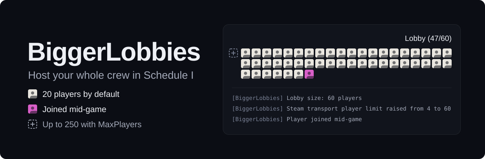

<p align="center">
  
</p>

Friends join any time, rejoin after a crash, and nobody loses progress. Only the host installs it.

<a href="https://github.com/mdoodm/BiggerLobbies/releases/latest"></a>


**[Download the latest release](https://github.com/mdoodm/BiggerLobbies/releases/latest)** or read [how to install](#install)

---

## What you get

Schedule I's co-op stops at 4 players, and one crash can end the night. BiggerLobbies takes those limits away, and everyone else joins with the normal game.

- **Room for everyone.** 20 players by default, and anything up to 250 if your PC and connection can carry it.
- **Invite whenever you like.** Your game goes online as your save loads, so friends can accept an invite or use Steam's **Join Game** at any point in the session.
- **Crashes don't end the session.** A player whose game crashes can come straight back in, without you restarting.
- **Nobody loses progress.** The world saves every 5 minutes, each player every 30 seconds, and everything saves the moment someone drops.
- **Everyone sees the same plants.** Water levels and growth stay in step for every player, so a watered pot never shows as dry.

## Install

You need **Schedule I 0.4.7** (the default Steam branch).

1. Install <a href="https://github.com/LavaGang/MelonLoader/releases/latest"><b>MelonLoader v0.7.3</b></a> or later into the game folder.
2. Download `BiggerLobbies_Il2cpp.dll` from the [latest release](https://github.com/mdoodm/BiggerLobbies/releases/latest) and put it in `Schedule I\Mods\`.
3. Launch the game, load a save, and invite your friends.

Each release lists the DLL's SHA-256. To check your download in PowerShell:

```
Get-FileHash .\BiggerLobbies_Il2cpp.dll -Algorithm SHA256
```

> [!TIP]
> **Losing leaves, petrol or deliveries?** That's a bug in the base game, not the lobby. The companion mod [**ItemSafety**](https://github.com/mdoodm/ItemSafety) catches it on the host. It's in alpha, so back up your saves first.

## Settings

Everything is on by default. After the first launch, change settings in `UserData\MelonPreferences.cfg` under `[BiggerLobbies]`, then restart the game.

| Setting | Default | What it does |
|---|---|---|
| `MaxPlayers` | `20` | Lobby size, from 4 to 250. See [hosting big lobbies](docs/hosting-big-lobbies.md) |
| `AlwaysHostLobby` | `true` | Go online automatically when you load a save |
| `LateJoinEnabled` | `true` | Let players join a game that has already started |
| `AutoSaveEnabled` | `true` | Save the world every few minutes, and when a player leaves |
| `AutoSaveMinutes` | `5` | Real-time minutes between world saves |
| `PlayerSaveEnabled` | `true` | Save each connected player between world saves |
| `PlayerSaveSeconds` | `30` | Seconds between player saves |
| `PlantSyncEnabled` | `true` | Send pot water levels and growth to every player |
| `PlantSyncMinutes` | `30` | In-game minutes between full resyncs of each pot |

There are also two [testing tools](docs/hosting-big-lobbies.md#testing-tools) for checking a big lobby without a big group. Leave them at `0`.

## Good to know

- Friends don't need the mod. If they run MelonLoader for other mods, it must be v0.7.3 or later.
- Every player needs the same content mods as the host. A mod that adds new items or objects on the host but not on a friend's game breaks their world.
- With r2modman, launch with Start modded, not from Steam.
- It's built for the Il2Cpp game, the default Steam branch. The Mono (alternate) branch isn't supported on 0.4.7.
- MelonLoader won't load it alongside ModManager & PhoneApp.

## Read more

| Page | For when you want to |
|---|---|
| [Hosting big lobbies](docs/hosting-big-lobbies.md) | Go past 20 players, understand the limits, or test a big lobby on your own |
| [Troubleshooting](docs/troubleshooting.md) | Fix a load error, a friend who can't join, or lost progress |
| [Coming from ifBars/BiggerLobbies](docs/coming-from-ifbars.md) | Switch from the original mod and see what changed |
| [How it works](docs/how-it-works.md) | Read what each fix does inside the game, or build from source |
| [Changelog](CHANGELOG.md) | See what's new in each version |

Found a bug, or ran a big session? [Open an issue](https://github.com/mdoodm/BiggerLobbies/issues/new/choose). The templates ask for the logs that help.

## Credits

BiggerLobbies was created by **Bars** ([ifBars/BiggerLobbies](https://github.com/ifBars/BiggerLobbies)). This fork, with the 0.4.7 update and everything since, is by [mdoodm](https://github.com/mdoodm), with AI assistance. Released under the [MIT licence](LICENSE).
