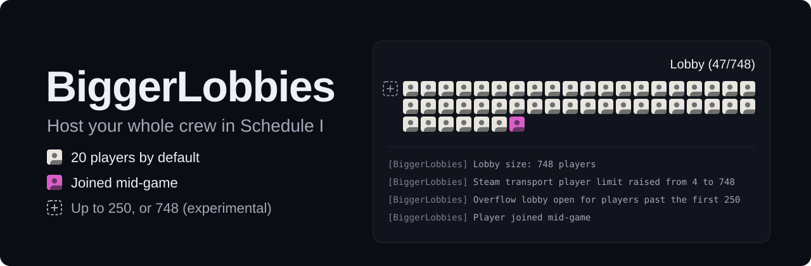
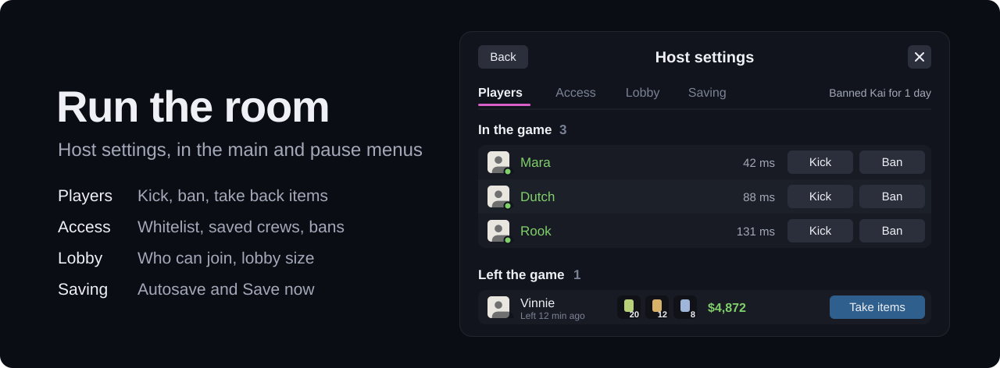
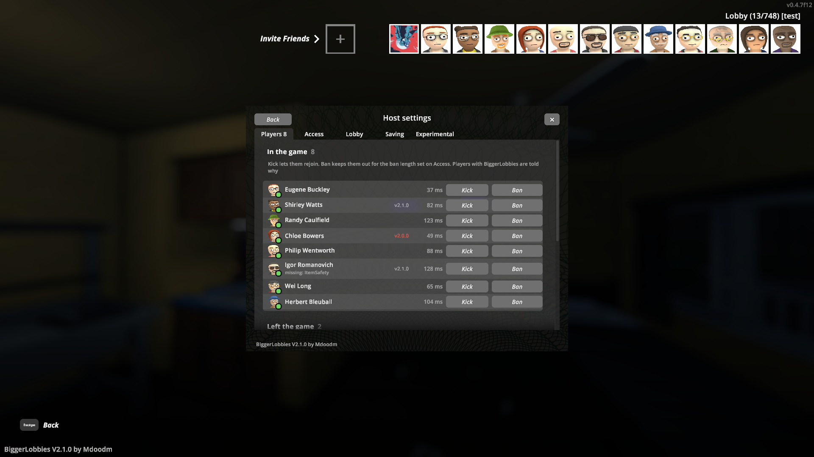
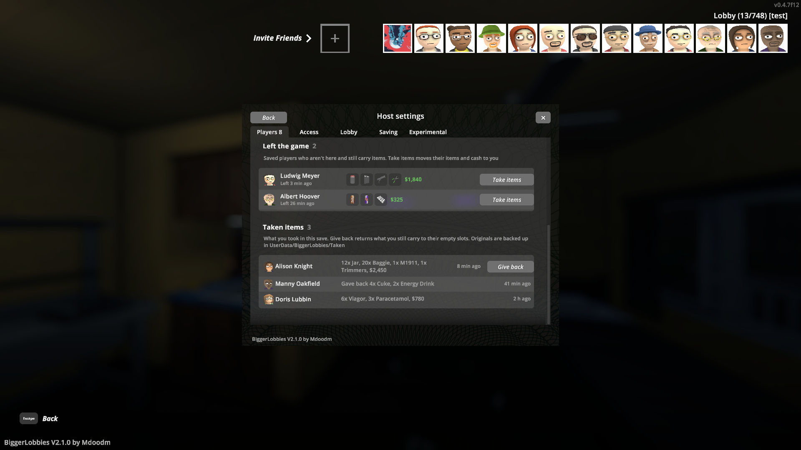
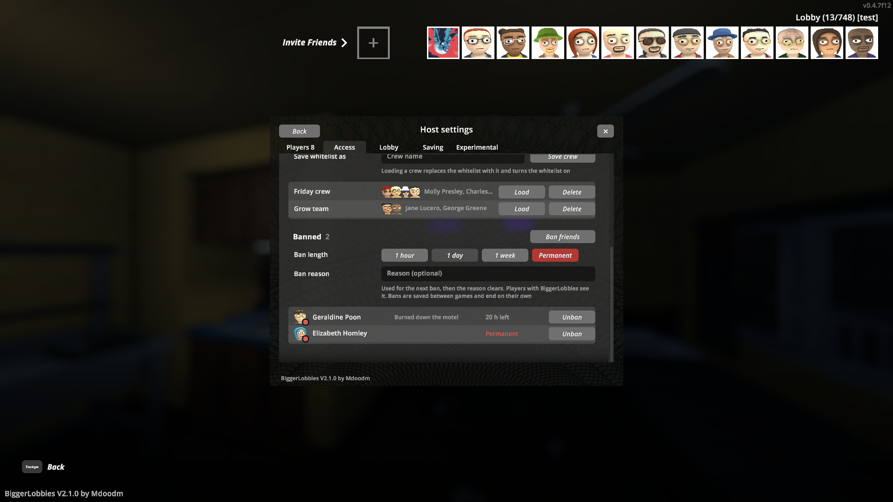
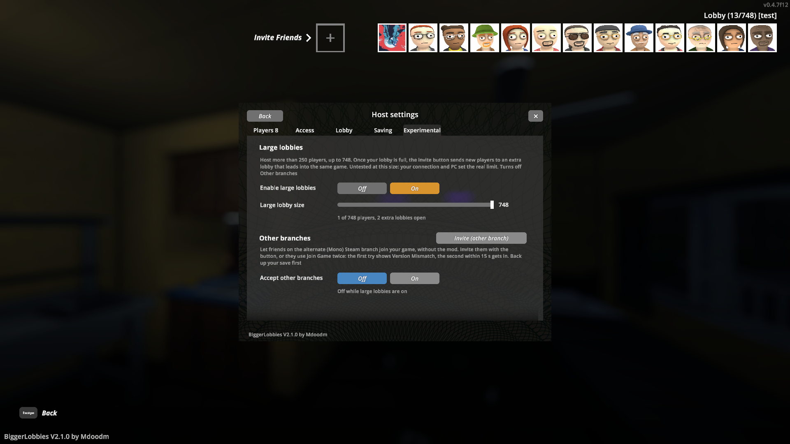

<p align="center">
  
</p>

Friends join any time, rejoin after a crash, and nobody loses progress. Only the host installs it.

<a href="https://github.com/mdoodm/BiggerLobbies/releases/latest"></a>


**[Download the latest release](https://github.com/mdoodm/BiggerLobbies/releases/latest)** or read [how to install](#install)

---

## What you get

Schedule I's co-op stops at 4 players, and one crash can end the night. BiggerLobbies takes those limits away, and everyone else joins with the normal game.

- **Room for everyone.** 20 players by default, and anything up to 250 if your PC and connection can carry it. Up to 748 with the experimental large lobbies.
- **Invite whenever you like.** Your game goes online as your save loads, so friends can accept an invite or use Steam's **Join Game** at any point in the session.
- **Crashes don't end the session.** A player whose game crashes can come straight back in, without you restarting.
- **Nobody loses progress.** The world saves every 5 minutes, each player every 30 seconds, and everything saves the moment someone drops.
- **Everyone sees the same plants.** Water levels and growth stay in step for every player, so a watered pot never shows as dry.

## Run the room

<p align="center">
  
</p>

**Host settings** sits under Settings in the main menu and the pause menu, or press **F6** while you host. Changes apply straight away, without a restart.

- **Players.** See everyone's ping. Kick lets them rejoin; Ban keeps them out for an hour, a day, a week or for good, with an optional reason that stays on your side. Players who also have BiggerLobbies are told whether they were kicked, banned or not on the whitelist, and removed players drop off your lobby screen. For players with BiggerLobbies you also see their version and any mods they're missing.
- **Take items.** Someone grabbed the product and left? Move their items and cash into your inventory, and they don't get them back if they rejoin. Every take is logged, with a copy of what they had. Changed your mind? **Give back** returns what you still carry to their empty slots.
- **Access.** Build a whitelist from your Steam friends, save it as a crew, and load it next session in one click. Bans are saved between games and end on their own.
- **Lobby.** Private, Friends only or Open, and the lobby size, even while friends are in.
- **Experimental.** Large lobbies past 250 players, or accept friends on the other Steam branch too, with no mod on their side. See [Good to know](#good-to-know).
- **Saving.** How often the world and each player save, plus a Save now button.
- **Discord.** Your profile shows "Hosting a lobby, Friends only (3 of 20)" under Playing Schedule I. Player count, lobby type and save name can each be turned off; the save name is off by default.

Settings that could cause trouble show in amber when they're on, and the bottom-left corner of your screen shows which BiggerLobbies version is running.

<details>
<summary><b>Screenshots</b></summary>

The players, bans and crews here are the game's own NPCs, from the `DebugShowcase` testing tool.

| | |
|---|---|
|  |  |
|  |  |

</details>

## Install

You need **Schedule I 0.4.7**, on either Steam branch.

1. Install <a href="https://github.com/LavaGang/MelonLoader/releases/latest"><b>MelonLoader v0.7.3</b></a> or later into the game folder.
2. Download the DLL for your branch from the [latest release](https://github.com/mdoodm/BiggerLobbies/releases/latest) and put it in `Schedule I\Mods\`:

   | Steam branch | DLL |
   |---|---|
   | Default (most players) | `BiggerLobbies_Il2cpp.dll` |
   | `alternate` (Mono) | `BiggerLobbies_Mono.dll` |

   Not sure which you're on? Put both in `Mods`. MelonLoader loads the right one and skips the other (see [Good to know](#good-to-know)). r2modman installs both for you.
3. Launch the game, load a save, and invite your friends.

Updating? Replace the DLL. Your settings, bans and crews carry over, and they're shared by both builds.

Each release lists the SHA-256 of both DLLs. To check your download in PowerShell:

```
Get-FileHash .\BiggerLobbies_*.dll -Algorithm SHA256
```

> [!TIP]
> **Losing leaves, petrol or deliveries?** That's a bug in the base game, not the lobby. The companion mod [**ItemSafety**](https://github.com/mdoodm/ItemSafety) catches it on the host. It's in alpha, so back up your saves first.

## Settings

Everything is on by default, and most of it is easier to change in **Host settings**. To edit the file instead, open `UserData\MelonPreferences.cfg` after the first launch, change values under `[BiggerLobbies]`, then restart the game.

<details>
<summary><b>All settings</b></summary>

**Lobby and access**

| Setting | Default | What it does |
|---|---|---|
| `MaxPlayers` | `20` | Lobby size, from 4 to 250. See [hosting big lobbies](docs/hosting-big-lobbies.md) |
| `LobbyPrivacy` | `FriendsOnly` | Who can join: `Private` (invite only), `FriendsOnly` or `Open` (strangers can join too) |
| `WhitelistEnabled` | `false` | Only players on the whitelist can join, and players already in who aren't on it are removed. The list starts empty each time you start the game, and nobody is removed while it's empty |
| `SavedCrews` | empty | Named whitelists. Easiest to manage in Host settings |
| `BannedPlayers` | empty | Banned Steam IDs, with an optional end time. Saved between games |
| `HostPanelKey` | `F6` | Key that opens Host settings while you host |

**Discord**

| Setting | Default | What it does |
|---|---|---|
| `DiscordPresence` | `true` | Show what you're doing under "Playing Schedule I" on Discord. Needs Discord running on your PC. Under Proton it needs a Discord IPC bridge |
| `DiscordShowPlayers` | `true` | Show the player count, like (3 of 20) |
| `DiscordShowLobbyType` | `true` | Show Friends only, Open or Private |
| `DiscordShowSaveName` | `false` | Show your organisation's name. Anyone who can see your profile can read it |
| `DiscordAppId` | Schedule I's | The Discord application the presence is sent as. The default is Discord's own entry for the game, which has no logo. Register your own at discord.com/developers to show one |
| `IgnoredModNames` | empty | Mod names, separated by commas, to leave out when comparing your mods with a player's. HUD mods and MLVScan are always left out |

**Joining**

| Setting | Default | What it does |
|---|---|---|
| `AlwaysHostLobby` | `true` | Go online automatically when you load a save |
| `LateJoinEnabled` | `true` | Let players join a game that has already started |

**Saving and sync**

| Setting | Default | What it does |
|---|---|---|
| `AutoSaveEnabled` | `true` | Save the world every few minutes, and when a player leaves |
| `AutoSaveMinutes` | `5` | Real-time minutes between world saves |
| `PlayerSaveEnabled` | `true` | Save each connected player between world saves |
| `PlayerSaveSeconds` | `30` | Seconds between player saves |
| `RestoreLeftWith` | `true` | When a player rejoins, put their saved items and clothes back to exactly what they left with, minus anything you took |
| `PlantSyncEnabled` | `true` | Send pot water levels and growth to every player |
| `PlantSyncMinutes` | `30` | In-game minutes between full resyncs of each pot |

**Logs**

| Setting | Default | What it does |
|---|---|---|
| `DiagnosticLog` | `false` | Write detailed lines to the MelonLoader log. Otherwise only warnings and errors are logged |

There are also two [testing tools](docs/hosting-big-lobbies.md#testing-tools) for checking a big lobby without a big group. Leave them at `0`.

**Testing only**

Leave these off for normal play.

| Setting | Default | What it does |
|---|---|---|
| `DebugShowcase` | `false` | Fills Host settings with made-up players: random NPCs from your save, with their portraits. For screenshots. Your real players, bans and logs are hidden while it's on, and buttons on the made-up rows do nothing. Load a save first: the main menu has no NPCs |
| `DebugTour` | `false` | Runs the menus by itself: screenshots Host settings on the main menu, loads your last save, then screenshots the lobby screen and every tab. The pictures go to `UserData/BiggerLobbies/Tour` |
| `DebugCrossBranchKey` | empty | A key name, such as `F8`. While you host, it switches your lobby between your branch and the other one by hand. Leave empty to turn it off |

**Experimental**

| Setting | Default | What it does |
|---|---|---|
| `ExperimentalLargeLobbies` | `false` | Allows a `MaxPlayers` past 250, up to 748. Past 250, players join through up to two hidden overflow lobbies. Turns off `CrossBranchLobby`. Untested at this size. Easiest to set on the Experimental tab |
| `CrossBranchLobby` | `false` | While you host, also open a hidden lobby for friends on the other Steam branch, so both branches can join. Easiest to turn on in Host settings, on the Experimental tab. See [Good to know](#good-to-know) |

</details>

## Good to know

- Friends don't need the mod. If they run MelonLoader for other mods, it must be v0.7.3 or later.
- Every player needs the same content mods as the host. A mod that adds new items or objects on the host but not on a friend's game breaks their world.
- With r2modman, launch with Start modded, not from Steam.
- Normally everyone in a lobby must be on the same Steam branch. A player on the other branch gets "Version Mismatch" (`0.4.7f12` and `0.4.7f12 Alternate`) from the game itself.
- **Playing across branches (experimental).** In Host settings, on the Experimental tab, set **Accept other branches** to On. While you host, a second, hidden lobby opens for the other branch, and both lead into your game. Friends on the other branch don't need the mod:
  - **Invite (other branch)** on the same tab invites them straight in.
  - With Steam's **Join Game** they see "Version Mismatch" once. Your lobby then accepts their branch for 15 seconds, so their second try works. Friends on your branch who try during those seconds get the same message once, and their retry works.
  - Both lobbies share your lobby size.

  The two builds may not stay fully in sync, so back up your save first. Results are welcome in an [issue](https://github.com/mdoodm/BiggerLobbies/issues/new/choose), with both players' logs.
- **Large lobbies (experimental).** Steam caps one lobby at 250 people. With **Enable large lobbies** on the Experimental tab, the size goes up to 748: once your lobby is full, your invite button sends new players to one of up to two extra lobbies that lead into the same game. Steam's Join Game only reaches the first lobby. Nobody has played with anywhere near this many people, so your connection and PC set the real limit. See [Hosting big lobbies](docs/hosting-big-lobbies.md#past-250-experimental).
- With both DLLs in `Mods`, the log shows the one for the other branch being skipped. On the default branch that's a short `'BiggerLobbies (Mono)' is incompatible` notice. On the `alternate` branch it's a red `Failed to load Melon 'BiggerLobbies_Il2cpp'` error with a stack trace. Both are expected and harmless. Delete the other DLL if you'd rather not see them.
- The Mono build shows as `BiggerLobbies (Mono)` in the log.
- MelonLoader won't load it alongside ModManager & PhoneApp.

## Read more

| Page | For when you want to |
|---|---|
| [Hosting big lobbies](docs/hosting-big-lobbies.md) | Go past 20 players, understand the limits, or test a big lobby on your own |
| [Troubleshooting](docs/troubleshooting.md) | Fix a load error, a friend who can't join, or lost progress |
| [Coming from ifBars/BiggerLobbies](docs/coming-from-ifbars.md) | Switch from the original mod and see what changed |
| [How it works](docs/how-it-works.md) | Read what each fix does inside the game, or build from source |
| [Changelog](CHANGELOG.md) | See what's new in each version |

Found a bug, or ran a big session? [Open an issue](https://github.com/mdoodm/BiggerLobbies/issues/new/choose). The templates ask for the logs that help.

## Credits

BiggerLobbies was created by **Bars** ([ifBars/BiggerLobbies](https://github.com/ifBars/BiggerLobbies)). This fork, with the 0.4.7 update and everything since, is by [mdoodm](https://github.com/mdoodm), with AI assistance. Released under the [MIT licence](LICENSE).
