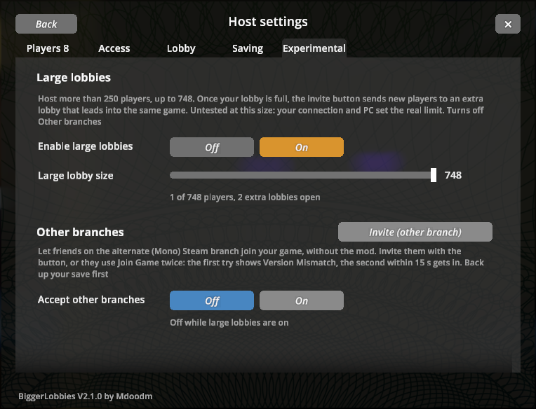

# Experimental features

[Back to the README](../README.md)

Two features are still being tested: **large lobbies**, past 250 players, and **other branches**, where friends on the other Steam branch join your game. Both are off by default and live on the **Experimental** tab in Host settings. Only one can be on at a time, because both use Steam's hidden lobbies and an account only gets a few.

Back up your save before you try either one, and [tell us how it went](#tell-us-how-it-went).

  

## How both features work

Players get into your game through a Steam lobby. These features open up to two extra, hidden Steam lobbies next to yours. Every lobby leads into the same game, so a player who joins through one is an ordinary player once they're in: they sleep, trade and save like everyone else.

- **One shared size.** All your lobbies count towards your one lobby size, so the extra lobbies never let in more people than you set.
- **One state.** The extra lobbies copy yours: when your save is ready, the join messages, and kick and ban notices.
- **Clean exit.** An extra lobby you no longer need stops taking new players and closes once it's empty. Nobody gets cut off mid-game.
- **Join Game reaches one lobby.** Steam's **Join Game** on your profile always leads to your main lobby; hidden lobbies can't be its target. That's why each feature gets its own way in, below.

## Large lobbies

Steam caps one lobby at 250 people. Large lobbies take your size past that, up to **748**.

1. On the Experimental tab, set **Enable large lobbies** to On.
2. Move **Large lobby size** to the size you want. The Lobby tab's own slider stops at 250 and points here.

Past 250, the mod opens one or two extra lobbies as your save loads. You take a place in each lobby you host, so three lobbies hold 250 + 249 + 249 = 748 people.

| How a player gets in | What happens |
|---|---|
| Your invite, while your lobby has room | They join your main lobby, as usual |
| Your invite, once your lobby is full | The invite button invites them into an extra lobby with room |
| Steam's Join Game | Only reaches your main lobby, so it stops working once that's full |

The line under the slider shows how many players are in, out of your size, and how many extra lobbies are open. Your lobby screen only shows the main lobby.

**The real limit is your PC and connection.** You send every player's movement to every other player, so your upload grows with roughly the square of the player count: 750 players is about 9 times the traffic of 250. A test with 250 simulated players ran at 32 fps on average, 7 at the lowest, and they sent nothing over the network. Nobody has played with anywhere near 748 real people.

## Playing across branches

Schedule I 0.4.7 is on two Steam branches: the default one, and `alternate` (Mono). Normally a player on the other branch gets "Version Mismatch" from the game itself. With **Accept other branches** on, they can join your game, and they don't need the mod.

1. On the Experimental tab, set **Accept other branches** to On.
2. Host a save. An extra lobby for the other branch opens as it loads.
3. Invite friends on the other branch with **Invite (other branch)** on the same tab.

| How a player on the other branch gets in | What happens |
|---|---|
| **Invite (other branch)** | They join straight away |
| Steam's Join Game | They see "Version Mismatch" once. Your lobby then accepts their branch for 15 seconds, so their second try works |

During those 15 seconds a friend on your own branch who tries Join Game gets the same message once, and their retry works too.

**Back up your save.** The two builds are the same game version, but nobody has played a full session across branches yet. If something stays out of sync for one player, that's what we need to hear about.

## What's been tested

| Feature | Tested | Not tested yet |
|---|---|---|
| Large lobbies | On a default-branch host: both extra lobbies open next to the main one as a save loads, and close with it | Players joining through an extra lobby, and any session above 20 real players |
| Other branches | A Mono player joining a default-branch host, through an earlier manual switch: kicks, bans, Take items, Give back, harvesting, bagging and looting all worked | The extra lobby and the Join Game retry with real players, and a full session with sleeping and saving |

## Settings

| Setting | Default | What it does |
|---|---|---|
| `ExperimentalLargeLobbies` | `false` | Allows a `MaxPlayers` past 250, up to 748. Turns off `CrossBranchLobby` |
| `CrossBranchLobby` | `false` | Opens an extra lobby for friends on the other Steam branch while you host. Off while large lobbies are on |

You can only turn large lobbies off with 250 players or fewer in your game.

## Log lines

With `DiagnosticLog` on, the log shows each step:

| Line | Meaning |
|---|---|
| `create answered: lobby <id>` | Steam made an extra lobby, and the mod matched it to its own request |
| `Overflow lobby <id> open …` / `Cross-branch lobby <id> open …` | The extra lobby is ready |
| `Extra lobby <id>: <name> (…) joined` | A player came in through an extra lobby |
| `<name> left your lobby straight away, probably on the other branch` | The Join Game retry window opened |
| `Extra lobby: Steam couldn't create it` | Steam refused the extra lobby. It tries again 30 seconds later |
| `Extra lobby <id> closed (…)` | An extra lobby closed, with the reason |

## Tell us how it went

[Open an issue](https://github.com/mdoodm/BiggerLobbies/issues/new/choose) with your `MelonLoader\Latest.log`, and for other branches the joining player's log too. Say which feature, how many people joined, and what happened.
